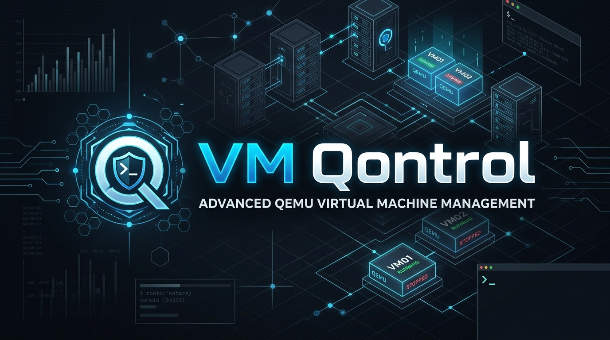

<p align="center"></p>

# VM Qontrol

A modern, intuitive manager for QEMU/KVM virtual machines on Linux. Create a machine in a few guided steps, download
an operating system from a catalog or use your own installer, and change every setting in a dialog that explains
what it does and what the recommended value is. It runs as you, with no background service, and keeps
one portable folder per machine. A few host changes (PCI handover, nested virtualization, huge pages, host drives, serial
port access) ask for your password once through the desktop's own prompt; USB passthrough needs none.

> **v0.0.5 is the first release.** Machines show in a viewer window (remote-viewer or spicy); a screen inside the app
> comes later. Guides live in the [wiki](https://github.com/codingncaffeine/VM-Qontrol/wiki).

## Install

| Where | How |
|-------|-----|
| Arch (AUR) | `yay -S vm-qontrol-bin` (or any AUR helper) |
| Debian / Ubuntu | download `vm-qontrol_<version>_amd64.deb` from [Releases](https://github.com/codingncaffeine/VM-Qontrol/releases), then `sudo apt install ./vm-qontrol_*_amd64.deb` |
| Any glibc distribution | `VMQontrol-<version>-linux-x64.tar.gz`: extract, run `./vmqontrol` |
| Alpine / musl | `VMQontrol-<version>-linux-musl-x64.tar.gz`: extract, run `./vmqontrol` |

.NET comes inside every package; QEMU and its helpers come from your distribution (table below). Run `vmq doctor`, or
open the app's welcome page, to see what is missing and the command that installs it. Each release carries a
`SHA256SUMS` file: `sha256sum -c --ignore-missing SHA256SUMS`.

## What it does

- **A library of machines** with live thumbnails, performance graphs and a serial console. Sort machines into
  **folders** (right-click the list → New folder, drag machines onto a folder, fold folders away), mark favorites,
  search, and power a whole folder on or off.
- **A New machine wizard**: your own ISO, or a download. Windows 10 and 11 come straight from Microsoft's own catalog
  (the one its Media Creation Tool uses, checked against Microsoft's checksums and made into an installer disc);
  other systems come from the quickget catalog; **Ready-made Linux** makes an Ubuntu, Debian, Fedora or Alpine machine
  from its cloud image in seconds, with your account and SSH key. Downloads are checked against their publishers'
  checksums, and against their signatures where the publisher signs (Ubuntu, Debian, Fedora, Alpine); every source is
  listed on the wiki's [Download Sources and Verification](https://github.com/codingncaffeine/VM-Qontrol/wiki/Download-Sources-and-Verification)
  page. The system is detected from the media, and **Easy Install** sets up
  Windows and the major Linux distributions unattended. "Lean Windows" leaves out the bundled promotions, games and
  ads while installing Microsoft's own, untouched Windows.
- **Settings that explain themselves**: memory, processors, disks, CD/DVD, network, USB, sound, display, TPM,
  firmware and boot, each saying what it does, the recommended value, and when a change takes effect. Memory and
  processors can be added while a machine runs. Disks on VirtIO, VirtIO SCSI, NVMe or SATA, grown or compacted;
  speed limits; nested virtualization; a VirtIO socket for SSH without a network. Every saved change is kept in a
  history you can go back to.
- **Guest tools, guided**: the page says when a machine has none (copy and paste, screen resizing and resolutions need
  them) and puts the driver disc in for you.
- **Snapshots** taken while a machine runs, full and linked clones, templates, suspend and resume, and machines that
  throw their changes away at power off.
- **Safe host shutdown**: when this computer shuts down, running machines are suspended in the time it allows, and the
  shut-down dialog names them; after sleep, the guests' clocks are set right. No root and no system service.
- **Open a machine's disk** in the file manager while it is off, read-only by default, through libguestfs: copy files
  out, or fix a machine that will not boot. The disk is read in a small helper machine, never by this computer's kernel.
- **Shared folders that set themselves up**: share a folder and it appears in the machine on its own, a drive named
  after it in Windows (WinFsp is installed for you) or `/mnt/shared/NAME` in Linux, mounted again at every start.
  Files belong to the machine's account inside it and to you on this computer.
- **Devices**: USB passthrough from a toolbar menu (no password), host drives (a disk, a partition or a CD/DVD drive,
  read-only unless you allow writing), host serial ports, PCI passthrough with CPU pinning and huge pages for gaming
  and GPU work.
- **Networking**: NAT with port forwarding and one-click SSH, bridged networking, private networks between machines
  with their own addresses (a virtual network editor), a network cable switch and traffic capture.
- **Import** from quickemu, VMware, VirtualBox, OVA and libvirt; **export** as a portable folder, one .tar file, or a
  quickemu .conf.
- **Keyboard first**: Ctrl+K finds every action by name; Ctrl+? lists the shortcuts (Ctrl+N new machine, Ctrl+B power
  on, Ctrl+E shut down, Ctrl+D settings, Ctrl+M snapshot…).
- **`vmq`**, a command-line tool on the same engine: create, clone, start, shut down, suspend, import, share folders, run programs in a guest, copy files.
- **A host check** that names anything missing and the command that installs it on your distribution.

New here? [Getting started](https://github.com/codingncaffeine/VM-Qontrol/wiki/Getting-Started),
[Troubleshooting](https://github.com/codingncaffeine/VM-Qontrol/wiki/Troubleshooting), and the rest of the
[wiki](https://github.com/codingncaffeine/VM-Qontrol/wiki).

## Requirements (Linux)

| Need | Arch | Debian / Ubuntu | Fedora |
|------|------|-----------------|--------|
| QEMU | `qemu-desktop` | `qemu-system-x86 qemu-utils` | `qemu-system-x86 qemu-img` |
| UEFI firmware | `edk2-ovmf` | `ovmf` | `edk2-ovmf` |
| TPM (Windows 11) | `swtpm` | `swtpm swtpm-tools` | `swtpm swtpm-tools` |
| Viewer | `spice-gtk` or `virt-viewer` | `spice-client-gtk` or `virt-viewer` | `spice-gtk-tools` or `virt-viewer` |
| OS detection | `osinfo-db` | `osinfo-db` | `osinfo-db` |
| Shared folders (optional) | `virtiofsd` | `virtiofsd` | `virtiofsd` |
| Faster user networking (optional) | `passt` | `passt` | `passt` |
| Windows downloads (optional) | `wimlib libisoburn` | `wimtools xorriso libarchive-tools` | `wimlib-utils xorriso bsdtar` |
| OS download catalog (optional) | `quickemu` | `quickemu` | `quickemu` |
| Download signatures (optional) | `gnupg` | `gpgv` | `gnupg2` |

**Alpine and other musl distributions** are supported for building from source:
`apk add dotnet10-sdk qemu-system-x86_64 qemu-img ovmf swtpm virt-viewer osinfo-db` (plus `virtiofsd passt` if
wanted, `wimlib xorriso libarchive-tools` for Windows downloads, and `gpgv` for download signatures). Alpine's UEFI firmware has no Secure Boot build, and quickget is not packaged there, so the download
catalog is unavailable unless you install quickemu yourself.

Your user needs access to `/dev/kvm`, through the `kvm` group or your distribution's default rule.

## Building

```bash
dotnet build VmQontrol.slnx -c Release
src/VmQontrol.App/bin/Release/net10.0/vmqontrol
```

.NET 10 SDK required (on Alpine, `dotnet10-sdk`). `VMQONTROL_HOME=DIR` keeps every setting, log and machine under DIR, which is useful for trying
a build without touching your real machines.

## License

GPL-3.0-or-later. See [LICENSE](LICENSE) and [THIRD-PARTY-NOTICES.md](THIRD-PARTY-NOTICES.md).
